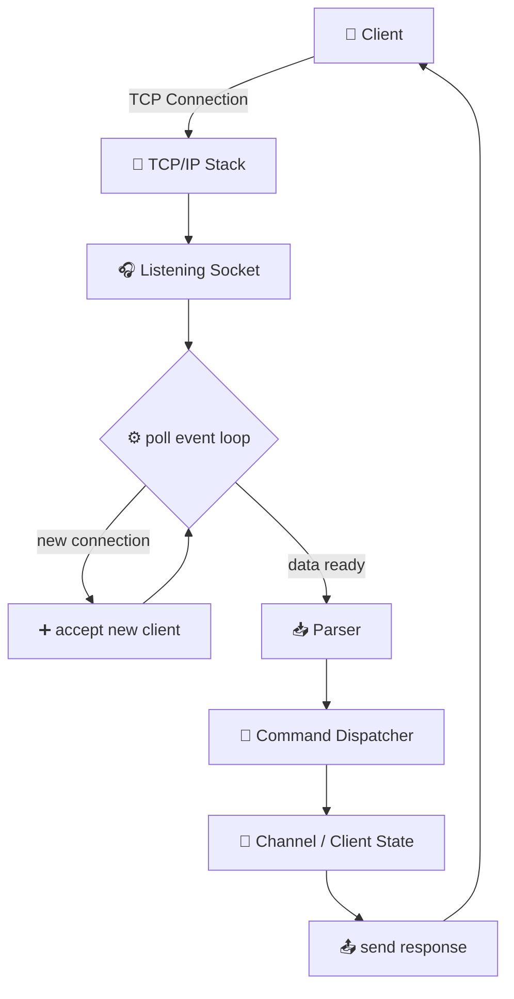
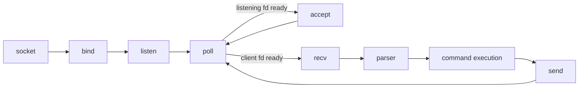
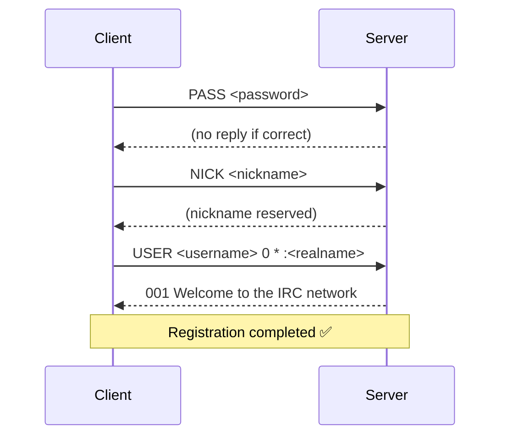

*This project has been created as part of the 42 curriculum by aschalh, oelmanso.*

<div align="center">

# 🌐 ft_irc — A C++98 IRC Server Built From Scratch

**A lightweight, RFC-compliant Internet Relay Chat server implemented in raw C++98, powered by a single-threaded, non-blocking `poll()` event loop.**

[](https://en.wikipedia.org/wiki/C%2B%2B98)
[](https://42.fr)
[](https://1337.ma/)
[](https://www.linux.org/)
[](https://en.wikipedia.org/wiki/Transmission_Control_Protocol)
[](https://en.wikipedia.org/wiki/Internet_Relay_Chat)

</div>

---

## 📑 Table of Contents

- [About the Project](#-about-the-project)
- [Features](#-features)
- [Architecture](#-architecture)
- [Server Workflow](#-server-workflow)
- [Project Structure](#-project-structure)
- [IRC Registration Flow](#-irc-registration-flow)
- [Supported Commands](#-supported-commands)
- [Channel Modes](#-channel-modes)
- [Bonus: IRC Bot](#-bonus-irc-bot)
- [Non-blocking I/O](#-non-blocking-io)
- [Signal Handling](#-signal-handling)
- [Build](#-build)
- [Usage](#-usage)
- [Testing](#-testing)
- [Resources](#-resources)
- [AI Usage](#-ai-usage)

---

## 📖 About the Project

### What is IRC?

**Internet Relay Chat (IRC)** is a text-based, real-time messaging protocol dating back to 1988. Clients connect to a central **server** over TCP, join **channels** (chat rooms), and exchange messages using a simple line-based text protocol. Despite its age, IRC remains widely used today for open-source project communication, gaming communities, and DevOps tooling — precisely because it is simple, extensible, and battle-tested.

### What is ft_irc?

**ft_irc** is a from-scratch implementation of an IRC server written in **C++98**, built as part of the 42 School curriculum. It handles multiple simultaneous client connections, authenticates users, manages channels, and implements a meaningful subset of the IRC protocol as defined in **RFC 1459** and **RFC 2812**.

### Objective

The project's core constraint — and its main learning objective — is this:

> **The server must handle an arbitrary number of clients without ever blocking, and without spawning a thread or process per client.**

This forces a deep, hands-on understanding of:

- TCP socket programming (`socket`, `bind`, `listen`, `accept`)
- Event-driven I/O multiplexing
- Manual protocol parsing over an unreliable, streaming transport
- Resource lifecycle management (RAII, Rule of Three) in a long-running server process

### Why Non-Blocking Sockets?

A traditional blocking server that calls `recv()` on one client at a time would freeze the moment one client goes idle — every other client would be starved. **Non-blocking sockets** ensure that a read/write call returns immediately (with `EWOULDBLOCK`/`EAGAIN`) instead of stalling the entire process, allowing the server to stay responsive to *all* clients at once.

### Why `poll()` Instead of Threads?

Spawning a thread per client doesn't scale — thousands of threads mean thousands of stacks, context switches, and synchronization headaches for shared state (channels, nicknames, etc.). Instead, `ft_irc` uses **`poll()`** to monitor many file descriptors in a single thread, and only acts on the ones that are actually ready for I/O. This is the same fundamental model used by high-performance servers like Redis and Nginx (via `epoll`/`kqueue`), scaled down to a portable POSIX primitive.

---

## ✨ Features

| Feature | Status | Description |
|---|:---:|---|
| `PASS` | ✔️ | Server password authentication |
| `NICK` | ✔️ | Nickname assignment & validation |
| `USER` | ✔️ | Username / realname registration |
| `JOIN` | ✔️ | Join or create channels |
| `PRIVMSG` | ✔️ | Direct & channel messaging |
| `TOPIC` | ✔️ | View / set channel topic |
| `INVITE` | ✔️ | Invite a user to a channel |
| `KICK` | ✔️ | Remove a user from a channel |
| `MODE` | ✔️ | Channel mode management |
| Multiple clients | ✔️ | Concurrent client handling, single-threaded |
| Non-blocking sockets | ✔️ | Zero blocking calls on the hot path |
| `poll()` | ✔️ | Single event loop for all I/O multiplexing |
| Signal handling | ✔️ | Clean response to `SIGINT` / `SIGTSTP` |
| Graceful shutdown | ✔️ | Sockets and clients closed cleanly on exit |

---

## 🏗️ Architecture



| Layer | Responsibility |
|---|---|
| **Client** | Any IRC-compatible client (netcat, irssi, HexChat, WeeChat) |
| **TCP/IP Stack** | OS-level transport of raw bytes between client and server |
| **Listening Socket** | Bound & listening `fd`, accepts new incoming connections |
| **poll() Loop** | Central event loop; watches all client `fd`s for readability |
| **Parser** | Buffers incoming bytes, splits on `\r\n`, tokenizes IRC commands |
| **Command Dispatcher** | Routes a parsed command to its handler (`JOIN`, `PRIVMSG`, ...) |
| **Channel / Client State** | In-memory model of channels, members, modes, topics |
| **send()** | Writes formatted IRC replies back to one or many sockets |

---

## 🔄 Server Workflow

The server lifecycle follows the canonical POSIX socket flow, extended with an event loop:



1. **`socket()`** — creates the listening file descriptor.
2. **`bind()`** — binds it to the chosen port on all interfaces.
3. **`listen()`** — marks the socket as ready to accept connections.
4. **`poll()`** — blocks (with a timeout) until *any* watched `fd` is ready.
5. **`accept()`** — called when the listening socket is readable; registers the new client `fd` in the `poll()` set.
6. **`recv()`** — called when a client `fd` is readable; reads available bytes into that client's buffer.
7. **Parser** — extracts complete `\r\n`-terminated lines from the buffer.
8. **Command execution** — the dispatcher validates and executes the parsed command against server state.
9. **`send()`** — replies are written back to the relevant socket(s), then the loop returns to `poll()`.

---

## 📂 Project Structure

```
ft_irc/
├── README.md
├── Mandatory/
│   ├── Server.hpp
│   ├── Client.hpp
│   ├── A_Channel.hpp
│   ├── signal.hpp
│   ├── main.cpp
│   ├── Server.cpp
│   ├── Client.cpp
│   ├── A_Channel.cpp
│   ├── Parser.cpp
│   ├── signal.cpp
│   └── helper.cpp
|   |__registration.cpp
|   |__mode.cpp
|   |__join.cpp
|   |__cmd_Channel.cpp
└── Bonus/
    ├── Makefile
    ├── main.cpp
    ├── Bot.hpp
    └── Bot.cpp
```

---

## 🤝 IRC Registration Flow

Every client must complete a three-step handshake before being considered "registered" on the server:



If `PASS` is wrong or missing, the server sends `464 ERR_PASSWDMISMATCH` and closes the connection. Registration only completes once all three commands have been received successfully.

---

## 💬 Supported Commands

<details>
<summary><b>PASS</b> — Authenticate with the server password</summary>

| | |
|---|---|
| **Purpose** | Validates the client against the server's connection password |
| **Syntax** | `PASS <password>` |
| **Example** | `PASS mysecretpass` |
| **Behavior** | Must be sent before `NICK`/`USER`. Wrong password → `464 ERR_PASSWDMISMATCH`, connection closed |

</details>

<details>
<summary><b>NICK</b> — Set or change a nickname</summary>

| | |
|---|---|
| **Purpose** | Assigns a unique nickname to the client |
| **Syntax** | `NICK <nickname>` |
| **Example** | `NICK zizou` |
| **Behavior** | Rejects duplicates (`433 ERR_NICKNAMEINUSE`) and invalid formats (`432 ERR_ERRONEUSNICKNAME`) |

</details>

<details>
<summary><b>USER</b> — Register username & realname</summary>

| | |
|---|---|
| **Purpose** | Provides username and realname, completing registration |
| **Syntax** | `USER <username> <mode> <unused> :<realname>` |
| **Example** | `USER zizou 0 * :Zinedine Zidane` |
| **Behavior** | Triggers `001 RPL_WELCOME` once `PASS`/`NICK` are also done |

</details>

<details>
<summary><b>JOIN</b> — Join or create a channel</summary>

| | |
|---|---|
| **Purpose** | Adds the client to a channel, creating it if it doesn't exist |
| **Syntax** | `JOIN <channel>{,<channel>} [<key>{,<key>}]` |
| **Example** | `JOIN #fortytwo secretkey` |
| **Behavior** | Enforces `+i`, `+k`, `+l` restrictions; broadcasts `JOIN` to channel members |

</details>

<details>
<summary><b>PRIVMSG</b> — Send a message</summary>

| | |
|---|---|
| **Purpose** | Sends a message to a user or a channel |
| **Syntax** | `PRIVMSG <target> :<message>` |
| **Example** | `PRIVMSG #fortytwo :Hello everyone!` |
| **Behavior** | Delivered to all channel members  the sender, or directly to a user |

</details>

<details>
<summary><b>TOPIC</b> — View or set the channel topic</summary>

| | |
|---|---|
| **Purpose** | Reads or updates a channel's topic |
| **Syntax** | `TOPIC <channel> [:<new topic>]` |
| **Example** | `TOPIC #fortytwo :Welcome to the 42 lounge` |
| **Behavior** | If `+t` is set, only operators may change the topic (`482 ERR_CHANOPRIVSNEEDED`) |

</details>

<details>
<summary><b>INVITE</b> — Invite a user to a channel</summary>

| | |
|---|---|
| **Purpose** | Invites a user, bypassing `+i` (invite-only) restrictions |
| **Syntax** | `INVITE <nickname> <channel>` |
| **Example** | `INVITE bilal #fortytwo` |
| **Behavior** | Only operators can invite on `+i` channels; target receives an `INVITE` notification |

</details>

<details>
<summary><b>KICK</b> — Remove a user from a channel</summary>

| | |
|---|---|
| **Purpose** | Forcibly removes a member from a channel |
| **Syntax** | `KICK <channel> <nickname> [:<reason>]` |
| **Example** | `KICK #fortytwo troll :spamming` |
| **Behavior** | Requires operator privileges; broadcasts `KICK` before removal |

</details>

<details>
<summary><b>MODE</b> — Manage channel & user modes</summary>

| | |
|---|---|
| **Purpose** | Sets or removes channel modes (`i`, `t`, `k`, `o`, `l`) |
| **Syntax** | `MODE <channel> <+/-modes> [params]` |
| **Example** | `MODE #fortytwo +ok bilal secret` |
| **Behavior** | Requires operator status; validates mode parameters per flag |

</details>

---

## 🔐 Channel Modes

| Mode | Name | Effect |
|:---:|---|---|
| `+i` | Invite-only | Only invited users can `JOIN` the channel |
| `+t` | Topic-protected | Only operators can change the `TOPIC` |
| `+k` | Key-protected | Requires a password to `JOIN` |
| `+o` | Operator | Grants a user channel admin privileges |
| `+l` | User limit | Caps the maximum number of members |

**Examples:**

```irc
MODE #fortytwo +i          :: channel becomes invite-only
MODE #fortytwo +t          :: only operators can change the topic
MODE #fortytwo +k mypass   :: JOIN now requires "mypass"
MODE #fortytwo +o bilal    :: bilal becomes an operator
MODE #fortytwo +l 10       :: channel capped at 10 members
```

---

## 🤖 Bonus: IRC Bot

The bonus deliverable is a lightweight **IRC client bot** that connects to `ft_irc` like any regular user and responds to specific commands automatically.

| Aspect | Description |
|---|---|
| **What it is** | A standalone client program using the same TCP/IRC protocol as any human client |
| **Connection** | Opens a TCP socket to the server's host/port, same handshake as a normal client |
| **Authentication** | Sends `PASS`, `NICK`, `BOT` (or a configured nickname), and `USER` on connect |
| **Listening** | Runs its own `poll()`/`recv()` loop, reading server messages continuously |
| **Parsing** | Reuses the same line-based `\r\n` parser to extract `PRIVMSG` events directed at it |
| **Responding** | Matches recognized commands and replies via `PRIVMSG` back to the channel or user |

<details>
<summary>💬 Example conversation</summary>

```
<zizou> !ping
<BOT>   pong 🏓
<zizou> !time
<BOT>   Server time: 2026-07-28 14:32:09 UTC
<zizou> !help
<BOT>   Available commands: !ping, !time, !help
```

</details>

---

## ⚡ Non-blocking I/O

`ft_irc` sets every socket (listening + client) to **non-blocking mode** via `fcntl(fd, F_SETFL, O_NONBLOCK)`. The entire program lives inside one `poll()` loop:

```cpp
std::vector<struct pollfd> fds; // listening socket + all client sockets

while (running)
{
    poll(fds.data(), fds.size(), -1);

    for (size_t i = 0; i < fds.size(); ++i)
    {
        if (fds[i].revents & POLLIN)
        {
            // listening socket → accept()
            // client socket    → recv()
        }
    }
}
```

`poll()` blocks *only* until at least one `fd` has data ready, then hands back exactly which ones. Because every socket is non-blocking, the subsequent `recv()`/`send()` calls never stall the loop — even a slow or silent client can't freeze the server for everyone else. This single-threaded, event-driven design avoids race conditions entirely: there is no shared state to lock, because there is only one thread touching it.

---

## 🛑 Signal Handling

`ft_irc` installs a handler for **`SIGINT`** (`Ctrl+C`) that flips a global `volatile sig_atomic_t running` flag instead of performing work inside the handler itself (unsafe operations like `close()` or `delete` are avoided in signal-handler context).

On the next `poll()` iteration, the main loop detects `running == false` and performs a **graceful shutdown**:

1. Notify all connected clients (`ERROR :Server shutting down`)
2. Close every client socket
3. Close the listening socket
4. Free all heap-allocated `Client`/`Channel` objects
5. Exit cleanly with status `0`

No dangling file descriptors, no memory leaks, no abrupt `TCP RST` for connected clients.

---

## 🔨 Build

| Command | Description |
|---|---|
| `make` | Compiles the project and produces the `ircserv` binary |
| `make clean` | Removes object files |
| `make fclean` | Removes object files **and** the binary |
| `make re` | `fclean` + full rebuild |

```bash
make        # build
make clean  # remove .o files
make fclean # remove .o files + binary
make re     # rebuild from scratch
```

---

## 🚀 Usage

```bash
./ircserv <port> <password>
```

| Argument | Description |
|---|---|
| `port` | TCP port the server listens on (e.g. `6667`, the standard IRC port) |
| `password` | Connection password clients must supply via `PASS` before registering |

**Example:**

```bash
./ircserv 6667 mysecretpass
```

---

## 🧪 Testing

<details>
<summary><b>netcat</b> — raw protocol testing</summary>

```bash
nc localhost 6667
PASS mysecretpass
NICK zizou
USER zizou 0 * :Zinedine Zidane
JOIN #fortytwo
PRIVMSG #fortytwo :Hello, world!
```

</details>

<details>
<summary><b>HexChat</b> — GUI client</summary>

1. Open **Network List** → **Add** → name it `ft_irc`
2. Server: `localhost/6667`, Password: your chosen password
3. Connect, then `/join #fortytwo`

</details>

<details>
<summary><b>irssi</b> — terminal client</summary>

```bash
irssi -c localhost -p 6667 -w mysecretpass
/join #fortytwo
```

</details>

<details>
<summary><b>WeeChat</b> — terminal client</summary>

```bash
weechat
/server add ft_irc localhost/6667 -password=mysecretpass
/connect ft_irc
/join #fortytwo
```

</details>

---

## 📚 Resources

- 📘 [RFC 1459 — Internet Relay Chat Protocol](https://datatracker.ietf.org/doc/html/rfc1459)
- 📘 [RFC 2812 — IRC Client Protocol](https://datatracker.ietf.org/doc/html/rfc2812)
- 📗 [Beej's Guide to Network Programming](https://beej.us/guide/bgnet/)
- 📙 [`poll()` — man7.org](https://man7.org/linux/man-pages/man2/poll.2.html)
- 📙 [`socket()` — man7.org](https://man7.org/linux/man-pages/man2/socket.2.html)

---

## 🧠 AI Usage

AI tools were used **exclusively as a learning aid** during development — never to generate the project itself. Specifically, AI assistance was used to:

- Understand low-level networking concepts (TCP handshakes, socket states, `poll()` internals)
- Clarify ambiguous points in RFC 1459 / RFC 2812
- Review and improve the clarity of this documentation

All server logic, protocol parsing, and architecture decisions were designed and implemented independently as part of the 42 School curriculum.

---

## 👨‍💻 Authors

- **aschalh**
- **oelmanso**

42 School / 1337 Coding School

---

<div align="center">

Built with 🖤 in C++98 — no external libraries, no shortcuts.

</div>